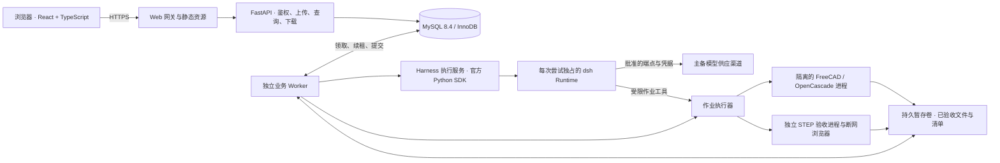

# 机械图纸 PDF 转三维 CAD 平台实施方案

设计日期：2026-11-20。目标部署环境为 Linux。首个交付里程碑是一份真实 PDF 从网页上传、服务器读图建模，到另一台电脑下载并打开 HTML、STEP 和验收报告的完整记录。

## 1. 需求边界与现有资产

每个产品版本交付可离线双击打开的单文件 3D HTML、含 B-Rep 实体的 STEP 和验收报告。FreeCAD 用于服务器建模，STEP 用于在 CAD 软件中选取和直接编辑几何，HTML 用于展示。用户按批次、料号和版本管理结果，浏览器关闭后任务由服务器继续执行。

| 检查项 | 首轮只读检查结果 | 实施用途 |
|---|---|---|
| 新工作区 `D:\projects\2Dto3D` | 检查时为空目录，尚未初始化 Git | 新建 React + TypeScript、FastAPI、独立 Worker、MySQL 8.4 和 Docker Compose 项目 |
| `D:\desktop\测试文件.pdf` | 1 页，104,504 字节，SHA-256 为 `be06c0a72ba49f73275dcbe515893495b8baadfd1a1aa19579603e2be8a92d2c` | M12 同页多型号回归。四针版总长 24.70 mm，五针和八针侧视图分别有 26.70 和 26.90 mm |
| `D:\projects\3D\output\freecad-M12A04` | 含原生模型、HTML、连接器 STEP、独立螺母 STEP 和报告。历史记录为 FreeCAD 1.1.4，连接器 7 个有效实体，螺母 1 个 | 对照部件范围和关键尺寸。独立螺母的展示位移不能当作安装位置。A 键、O 形圈等试建尺寸需按用途确认 |
| `D:\projects\3D\测试文件` | 另有 4 份 PDF，其中 2 份为双页，`WLT2F9-141XX0200.pdf` 有 270° 旋转页 | 已有 5 份共 7 页可用于分页、证据定位、多型号及多页测试 |
| `C:\Users\15692\.codex\skills\drawing-to-freecad` 与 `drawing-to-html` | 已有按指纹的页缓存、实体网格化、装配变换、查看器和打包资源。现有 FreeCAD 宏与导出器使用 `FreeCADGui` | 核对许可和依赖后将所需脚本、查看器及许可证纳入部署包。HTML 只复用从冻结实体导出网格的路线 |
| 本机环境 | 有 WSL 和 Docker CLI 29.5.3，检查时 Docker Desktop Linux Engine 未连接 | Linux 镜像、迁移、CAD 无界面运行和断网浏览器检查列为实施验收项 |

历史模型由已读出的尺寸生成，历史报告中的部分螺距检查读取原生特征属性。真实 AI 识图和 STEP 独立几何测量均需在新平台重新运行。

**容量和预算假设。** 首轮按每日 100 份 PDF、每批 50 份、单 PDF 32 MiB、单成品 64 MiB 规划。服务器采用 Linux x86-64、8 vCPU、32 GiB RAM 和 200 GiB SSD，模型与 CAD 各并发 2。初设预算为每产品版本 ¥10、每项目每日 ¥500，实际按配置单价与账单核算。压测后据实调整。

## 2. 架构与部署拓扑



| 边界 | 职责 |
|---|---|
| 模型 API | 对获准发送的图像、文字和工具描述作推理，返回读图结论、建模作业或差异解释。供应商请求 ID、实际模型和费用归入调用记录 |
| Harness Runtime | 在服务器加载固定 profile、只读技能和工具，驱动模型交互，记录会话与事件。每次尝试拥有独立工作区和 Harness home |
| 业务 Worker | 负责阶段依赖、预算、主备路由、截止时间、检查点、产物就绪条件和发布。状态持久化到 MySQL |
| CAD 作业执行器 | 每个生成脚本以非 root 身份在无网络容器中运行，只读根文件系统，只挂载本任务只读输入和可写输出。限制 CPU、内存、进程数及时间，模型密钥、数据库凭据和 Docker socket 留在隔离边界外 |
| 独立验收器 | 从冻结依据构造测量清单，加载交付字节并执行平台维护的测量及浏览器检查。建模脚本只有提交候选几何的权限 |

Compose 对外开放 HTTPS。数据库、作业执行器和 Harness 服务使用内部网络。Harness 可在同一台 Linux 服务器独立部署，也可迁至另一台服务器。模型凭据从服务器 secrets 或密钥服务注入。文件收到“已接收”回执时，原图、源记录和首阶段队列项已成功提交。

## 3. 官方 Harness SDK 接入

首轮核对到 PyPI 官方包 `deepseek-harness-sdk==0.2.2rc2`，精确依赖 `deepseek-harness-runtime-bin==0.2.2rc2`。该 RC 版本有 Linux x86-64 与 arm64 的 `manylinux_2_28` wheel，要求 Python ≥3.10。对应源码标签为 `dsh-v0.2.2-rc.2`，提交 `ddac96760b6edf8fa0fe17cbdcf0b512f4c12b2c`。PyPI 的近名包 `deepseek-harness` 属于其他仓库。开发时将官方 SDK、Runtime、依赖和 wheel 哈希一起锁定。[SDK 发行页](https://pypi.org/project/deepseek-harness-sdk/0.2.2rc2/) · [Runtime 发行页](https://pypi.org/project/deepseek-harness-runtime-bin/0.2.2rc2/) · [版本对应的官方指南](https://github.com/deepseek-ai/deepseek-harness/blob/dsh-v0.2.2-rc.2/docs/user/guide/python-sdk.md)

| 项目 | 该版本行为与平台配置 |
|---|---|
| 启动 | SDK 首次使用时启动配套 `dsh` 子进程，使用 stdio JSON-RPC。常规 SDK 执行无需系统 Node.js。显式提供绝对路径的 `cwd` 和 `dsh_home` |
| 图片 | 将页图以 Base64 和 `mimeType` 放入 `image` 内容块。管理员用随机图形、数字和方向题实测，通过后才能启用读图路由 |
| 工具与技能 | `sdk-minimal` 默认有 shell、`read_image` 和 `working_directory`。生产用 profile patch 移除通用 shell，启用 `dsh-skill`、`dsh-skill-filesystem`、`dsh-tool-skill`，通过 `customSkillDirs` 指向项目只读技能。受限工具负责提交 CAD 作业。启动验收检查实际工具名单，加载一个技能并执行一次工具探针 |
| 数据边界 | `cwd` 本身不能隔离文件。使用容器限制 Runtime 可见路径，关闭 `session-log-deepseek` 的默认日志附送。仅允许向项目批准的端点传输图纸 |
| 事件 | `on_notification` 接收活动事件。`RunResult` 提供 `events`、`notifications`、`finish_reason` 和 `final_response`。保留脱敏事件、结束原因、用量和供应商请求 ID，业务输出另经 schema 校验 |
| 超时与取消 | `initialize_timeout_seconds` 限握手，`request_timeout_seconds` 限协议应答。业务看门狗另限整阶段。该版协议没有按会话取消的 RPC。取消时关闭本次独占 Runtime，必要时终止进程组，并撤销关联 CAD 作业 |
| 恢复 | `resume_session(id)` 配合原工作区及 `dsh_home` 恢复持久历史。外部 shell 和 CAD 进程需重新建立。跨渠道接手在新会话载入业务检查点 |
| 重试 | 生产组合移除 `llm-retry` 重试执行器，并关闭出口客户端的隐式重试。统一由 Worker 设定次数、预算和退避。自动压缩上下文等附加模型请求也逐笔计量 |

[SDK 生命周期与图片格式](https://github.com/deepseek-ai/deepseek-harness/blob/dsh-v0.2.2-rc.2/python/sdk/README.md) · [取消协议](https://github.com/deepseek-ai/deepseek-harness/blob/dsh-v0.2.2-rc.2/packages/sdk/protocol/README.md) · [技能发现](https://github.com/deepseek-ai/deepseek-harness/blob/dsh-v0.2.2-rc.2/docs/subsystems/skills.md) · [Runtime 重试机制](https://github.com/deepseek-ai/deepseek-harness/blob/dsh-v0.2.2-rc.2/packages/llm/llm-retry/README.md)

### 最小图片调用

服务器需准备隔离的可写 home、已渲染的 `page-001.png`，通过环境注入 `DEEPSEEK_API_KEY` 及已实测支持图片的 `VISION_MODEL_ID`。兼容端点按适配器要求设置 `DEEPSEEK_BASE_URL`。以下示例对应已核对的 SDK 签名，真实凭据联调安排在 M0–M1。

```bash
python -m pip install 'deepseek-harness-sdk==0.2.2rc2'
```

```python
import base64
import os
from pathlib import Path

from deepseek_harness import DeepSeekHarness

workspace = Path("/work/attempt-001")
page = base64.b64encode((workspace / "page-001.png").read_bytes()).decode("ascii")

with DeepSeekHarness(
    provider="deepseek-official",
    model=os.environ["VISION_MODEL_ID"],
    profile="sdk-minimal",
    cwd=str(workspace),
    dsh_home="/state/attempt-001",
    initialize_timeout_seconds=30,
    request_timeout_seconds=30,
) as harness:
    result = harness.run(
        [
            {"type": "text", "text": "请读取第 1 页标题栏，返回料号及其图面位置。"},
            {"type": "image", "data": page, "mimeType": "image/png"},
        ],
        session_id="drawing-001-read",
        on_notification=lambda event: print(event.method),
    )
    if result.finish_reason != "completed":
        raise RuntimeError(f"读图未完成：{result.finish_reason}")
    print(result.final_response)
```

## 4. 从图纸到同源成品

系统分别标识源文件、产品版本和几何修订。源文件以原始字节 SHA-256 追溯。项目、料号、版本号共同标识一次产品交付，例如 `P-204 / V3`。`V3 / G1` 和 `V3 / G2` 分别标识该次交付中冻结的两份几何。发布后的改图建立新产品版本。

```text
文件已接收 → 分页与证据提取 → 合并多页读图 → 确定型号与视图归属
                                         ├─ 有歧义 → 待确认 → 续办
                                         └─ 已明确 → 按产品派生任务
产品任务 → 冻结依据与验收清单 → 选择或编写作业 → 建模 → 冻结几何 Gn
                                                       ├─ STEP → 独立回读测量
                                                       └─ 实体网格 → HTML → 断网检查
测量发现几何有误 → 记录差异 → 撤回旧几何产物 → 修模 → 冻结下一修订
同几何全部必需产物通过 → 生成验收报告 → 事务发布
```

1. **留存原图证据。** 矢量 PDF 提取文本、路径和页图。扫描页按页渲染，按需 OCR 与局部放大。保存原始页码、页面框、单位、旋转、裁剪范围及 PDF 坐标到显示坐标的变换。网页点击尺寸能在原页定位，包括 270° 旋转页。附件文字只作为图纸资料。
2. **一次读图，多型号派生。** 同一零件的多页联合解释。结果含料号、图版、单位、基准、视向、尺寸、公差、零件和装配位置。区分标注值、推导值和试建值并关联页区证据。用户可指定料号，或按明确型号分别生成。若结构、配合或视图归属有歧义，展示相关局部图并保存用户确认。
3. **冻结实体和部件范围。** Harness 选择经验证的同族作业或编写新作业。隔离环境输出精确实体、部件清单、装配变换及作业源码。平台重开并记录快照哈希。STEP 和 HTML 都从该快照与同一部件清单导出。展示位移、安装开孔参考草图和实际装配位置分别记录。
4. **从交付文件独立测量。** 验收器在独立进程重新导入 STEP，检查实体有效性与数量、拓扑、基准、单位、部件位置。连接器检查针数、朝向、孔距和有依据的螺距。板件按指定观察面检查非对称孔的有符号坐标，以识别镜像。轴类检查肩距与同轴性，齿形件检查齿数和有标注的齿形参数，装配检查实例及变换。先锁定型号独有尺寸，再与回读测量比较，可拦住选错型号却通过作业自检的情况。复杂差异由另一模型按原图复核，关键依据仍缺失则待确认。
5. **验证可用性。** HTML 内嵌查看器、网格、版本和说明，用断网浏览器从 `file://` 加载，验证实际模型可见，以及旋转、缩放、视角切换和部件开关。
6. **分项就绪，版本发布。** HTML 已验收、STEP 尚未成功时，显示“部分完成”并允许下载标明状态的 HTML。判定实体错误时撤回旧几何的下载资格，所有依赖产物失效。用户已下载的文件保留版本与几何哈希供追溯。正式发布要求当前几何修订的 HTML、STEP 均通过验收，且通过的报告引用同一修订。

**Linux CAD 锁版。** 首候选为 FreeCAD 1.1.4 官方 Linux x86-64 / Python 3.11 构建。先验证无桌面的 `FreeCAD`、`Part`、`MeshPart` 和 STEP 导入导出。已有 GUI 依赖确实需要显示服务时，在容器内使用 Xvfb。以实际运行输出锁定 FreeCAD、OpenCascade、Python、系统依赖、上游 SHA-256 与镜像 digest。[FreeCAD 1.1.4 官方发行](https://github.com/FreeCAD/FreeCAD/releases/tag/1.1.4)

## 5. MySQL 队列、计费与故障恢复

Worker 在 `READ COMMITTED` 短事务中按 `ready_at, id` 领取就绪阶段。使用 `SELECT … FOR UPDATE SKIP LOCKED`，写入 `owner`、`lease_until`，递增 `fence` 后立即提交并释放锁。模型、CAD 和浏览器均在事务外运行。初始租约 90 秒，每 20 秒按数据库时间续租。过期运行可重新入队。完成时重新锁行，校验持有者、租约代数、有效期和输入几何。旧 Worker 的迟到结果无法提交。

阶段幂等键由任务、阶段、输入清单哈希及生成器版本生成。阶段完成、检查点提交和后继阶段入队同事务执行。成品槽位由产品版本、几何修订、文件类型唯一标识。提交回执丢失时按幂等键查询，再核对哈希。持久暂存卷承接等待入库的已验收字节，任务临时目录可以清理。

读图、建模和复杂复核各有项目级主备顺序。每次调用检查项目准入、能力实测、启停、供应渠道、并发、冷却和预算。在锁定项目及配置行后预留费用和槽位。初始策略为每渠道对明确失败最多尝试两次，受阶段截止时间和预算约束。持续故障进入冷却，半开时只发一个探测。实际费用逐笔核销，供应商可能已接收但未返回的调用标为待对账。

| 故障 | 恢复动作 | 用户可见的复用与新增费用 |
|---|---|---|
| 图纸缺信息、型号含糊 | 落盘相关页区及具体问题，释放 Worker，收到确认后继续 | 已确认尺寸继续复用，等待期间无模型调用 |
| 短时 429、503 | 尊重 `Retry-After`，在截止时间内有限退避并加抖动。持续失败后切至合格的独立备用渠道 | 显示模型、耗时、尝试、切换原因及费用 |
| 密钥失效或额度耗尽 | 停用相关凭据或额度范围，检查独立备路 | 显示跳过原因与管理员修复动作 |
| 超时、断线或 Worker 中断 | 对照远端请求与检查点，收回租约、停止旧执行，从最近有效阶段恢复 | 显示复用阶段和可能已计费的待对账请求 |
| 仅 STEP 导出或传输失败 | 从原几何重试导出和独立回读 | 合格 HTML 可下载，只增加本地作业耗时 |
| 实体错误、孔位镜像 | 持久化证据与差异，撤回旧几何产物，回到建模并重导 | 复用读图及确认信息，修模用到的模型调用单独计费 |
| 仅数据库保存或发布失败 | 保留持久暂存字节，查询原事务结果，再补写缺项或重试发布 | 无需重跑模型、建模或导出 |
| 单文件或单型号失败 | 失败项进入待确认、可重试失败或部分完成，其他项继续领取 | 批次可查看完成项，只重试失败项 |

**备用模型接手实例。** 双页板件 `P-204 / V3` 的安装面来自第 1 页，定位孔来自第 2 页。独立回读发现 `G1` 的孔在基准左侧，图纸要求右侧。Worker 已持久化原页区、用户确认的观察面、标注尺寸、作业源码、当前几何和实测差异。主渠道修正时连续返回 429，Worker 记录请求并启动冷却。备用渠道在新 Harness 会话载入同一检查点，从“修正定位孔”继续。它生成 `V3 / G2`，验收器重新测量新 STEP 的有符号孔位，HTML 从 `G2` 导出并离线检查。该修订的 HTML、STEP 和通过的报告齐备后发布 `V3`。任务详情逐项显示复用读图、主渠道限流、备用修模、重新导出和对应费用。

## 6. MySQL 8.4 数据设计与首版迁移

`file_bytes` 存放完整文件字节。源文件、检查点、验收报告和成品通过 SHA-256 引用正文。检查点清单可以列出多个页图、局部坐标证据、用户确认尺寸、作业和几何。列表只查询元数据。以下 DDL 面向空的 MySQL 8.4 业务库。实施时通过 Alembic 管理同一建表顺序，并验证全新建库和已有数据升级。

```sql
SET NAMES utf8mb4;
SET SESSION default_storage_engine = InnoDB;

CREATE TABLE app_user (
  id BIGINT PRIMARY KEY AUTO_INCREMENT,
  login VARCHAR(160) NOT NULL UNIQUE,
  password_hash VARCHAR(255) NOT NULL,
  is_admin BOOLEAN NOT NULL DEFAULT FALSE
);

CREATE TABLE project (
  id BIGINT PRIMARY KEY AUTO_INCREMENT,
  name VARCHAR(160) NOT NULL,
  daily_budget_cny DECIMAL(14,4) NOT NULL,
  version_budget_cny DECIMAL(14,4) NOT NULL
);

CREATE TABLE project_member (
  project_id BIGINT NOT NULL,
  user_id BIGINT NOT NULL,
  role ENUM('reader','operator','admin') NOT NULL,
  PRIMARY KEY (project_id,user_id),
  KEY member_projects (user_id,project_id),
  FOREIGN KEY (project_id) REFERENCES project(id),
  FOREIGN KEY (user_id) REFERENCES app_user(id)
);

CREATE TABLE file_bytes (
  sha BINARY(32) PRIMARY KEY,
  byte_count BIGINT UNSIGNED NOT NULL,
  body LONGBLOB NOT NULL,
  CHECK (byte_count = OCTET_LENGTH(body))
);

CREATE TABLE upload_batch (
  id BIGINT PRIMARY KEY AUTO_INCREMENT,
  project_id BIGINT NOT NULL,
  user_id BIGINT NOT NULL,
  request_key VARBINARY(96) NOT NULL,
  created_at DATETIME(6) NOT NULL DEFAULT CURRENT_TIMESTAMP(6),
  UNIQUE (project_id,request_key),
  KEY batch_list (project_id,created_at,id),
  FOREIGN KEY (project_id) REFERENCES project(id),
  FOREIGN KEY (user_id) REFERENCES app_user(id)
);

CREATE TABLE source_file (
  id BIGINT PRIMARY KEY AUTO_INCREMENT,
  batch_id BIGINT NOT NULL,
  client_file_key VARBINARY(96) NOT NULL,
  filename VARCHAR(255) NOT NULL,
  sha BINARY(32),
  selection_json JSON NOT NULL,
  state ENUM('accepted','rejected') NOT NULL,
  error_text TEXT,
  UNIQUE (batch_id,client_file_key),
  CHECK (state <> 'accepted' OR sha IS NOT NULL),
  FOREIGN KEY (batch_id) REFERENCES upload_batch(id),
  FOREIGN KEY (sha) REFERENCES file_bytes(sha)
);

CREATE TABLE product_task (
  id BIGINT PRIMARY KEY AUTO_INCREMENT,
  source_id BIGINT NOT NULL,
  scope_key VARBINARY(192) NOT NULL,
  part_no VARCHAR(160),
  drawing_revision VARCHAR(80),
  state VARCHAR(32) NOT NULL,
  budget_cny DECIMAL(14,4) NOT NULL,
  UNIQUE (source_id,scope_key),
  KEY task_state (source_id,state),
  FOREIGN KEY (source_id) REFERENCES source_file(id)
);

CREATE TABLE product_version (
  id BIGINT PRIMARY KEY AUTO_INCREMENT,
  task_id BIGINT NOT NULL UNIQUE,
  project_id BIGINT NOT NULL,
  part_no VARCHAR(160) CHARACTER SET utf8mb4 COLLATE utf8mb4_bin NOT NULL,
  version_no INT UNSIGNED NOT NULL,
  current_geom INT UNSIGNED,
  state ENUM('draft','partial','published','withdrawn') NOT NULL DEFAULT 'draft',
  published_at DATETIME(6),
  UNIQUE (project_id,part_no,version_no),
  KEY library_list (project_id,state,published_at,id),
  FOREIGN KEY (task_id) REFERENCES product_task(id),
  FOREIGN KEY (project_id) REFERENCES project(id)
);

CREATE TABLE geometry_revision (
  version_id BIGINT NOT NULL,
  geom_no INT UNSIGNED NOT NULL,
  snapshot_sha BINARY(32) NOT NULL,
  evidence_sha BINARY(32) NOT NULL,
  job_sha BINARY(32) NOT NULL,
  generator VARCHAR(160) NOT NULL,
  PRIMARY KEY (version_id,geom_no),
  FOREIGN KEY (version_id) REFERENCES product_version(id),
  FOREIGN KEY (snapshot_sha) REFERENCES file_bytes(sha),
  FOREIGN KEY (evidence_sha) REFERENCES file_bytes(sha),
  FOREIGN KEY (job_sha) REFERENCES file_bytes(sha)
);

ALTER TABLE product_version ADD FOREIGN KEY (id,current_geom)
  REFERENCES geometry_revision(version_id,geom_no);

CREATE TABLE task_stage (
  id BIGINT PRIMARY KEY AUTO_INCREMENT,
  task_id BIGINT NOT NULL,
  stage_name VARCHAR(48) NOT NULL,
  idem_key BINARY(32) NOT NULL UNIQUE,
  input_sha BINARY(32) NOT NULL,
  output_sha BINARY(32),
  state ENUM('ready','running','done','waiting','failed','cancelled','stale') NOT NULL,
  ready_at DATETIME(6) NOT NULL,
  owner VARBINARY(96),
  fence BIGINT UNSIGNED NOT NULL DEFAULT 0,
  lease_until DATETIME(6),
  attempts INT UNSIGNED NOT NULL DEFAULT 0,
  error_code VARCHAR(64),
  error_text TEXT,
  KEY claim_stage (state,ready_at,id),
  KEY expired_stage (state,lease_until,id),
  KEY task_history (task_id,id),
  FOREIGN KEY (task_id) REFERENCES product_task(id),
  FOREIGN KEY (input_sha) REFERENCES file_bytes(sha),
  FOREIGN KEY (output_sha) REFERENCES file_bytes(sha)
);

CREATE TABLE stage_event (
  id BIGINT PRIMARY KEY AUTO_INCREMENT,
  stage_id BIGINT NOT NULL,
  fence BIGINT UNSIGNED NOT NULL,
  kind VARCHAR(48) NOT NULL,
  detail JSON NOT NULL,
  created_at DATETIME(6) NOT NULL DEFAULT CURRENT_TIMESTAMP(6),
  KEY stage_timeline (stage_id,id),
  FOREIGN KEY (stage_id) REFERENCES task_stage(id)
);

CREATE TABLE confirmation (
  id BIGINT PRIMARY KEY AUTO_INCREMENT,
  stage_id BIGINT NOT NULL,
  question JSON NOT NULL,
  answer JSON,
  answered_by BIGINT,
  answered_at DATETIME(6),
  FOREIGN KEY (stage_id) REFERENCES task_stage(id),
  FOREIGN KEY (answered_by) REFERENCES app_user(id)
);

CREATE TABLE engine_config (
  id BIGINT PRIMARY KEY AUTO_INCREMENT,
  sdk_version VARCHAR(40) NOT NULL,
  runtime_version VARCHAR(40) NOT NULL,
  profile_sha BINARY(32) NOT NULL,
  FOREIGN KEY (profile_sha) REFERENCES file_bytes(sha)
);

CREATE TABLE model_channel (
  id BIGINT PRIMARY KEY AUTO_INCREMENT,
  provider VARCHAR(96) NOT NULL,
  endpoint VARCHAR(512) NOT NULL,
  credential_ref VARCHAR(255) NOT NULL,
  failure_domain VARCHAR(96) NOT NULL,
  enabled BOOLEAN NOT NULL DEFAULT TRUE,
  cooldown_until DATETIME(6)
);

CREATE TABLE model_config (
  id BIGINT PRIMARY KEY AUTO_INCREMENT,
  engine_id BIGINT NOT NULL,
  channel_id BIGINT NOT NULL,
  model_id VARCHAR(160) NOT NULL,
  enabled BOOLEAN NOT NULL DEFAULT TRUE,
  probe_result JSON,
  tested_at DATETIME(6),
  max_concurrent INT UNSIGNED NOT NULL,
  prices_json JSON NOT NULL,
  FOREIGN KEY (engine_id) REFERENCES engine_config(id),
  FOREIGN KEY (channel_id) REFERENCES model_channel(id)
);

CREATE TABLE model_route (
  project_id BIGINT NOT NULL,
  purpose ENUM('read','model','review') NOT NULL,
  priority INT UNSIGNED NOT NULL,
  config_id BIGINT NOT NULL,
  PRIMARY KEY (project_id,purpose,priority),
  UNIQUE (project_id,purpose,config_id),
  FOREIGN KEY (project_id) REFERENCES project(id),
  FOREIGN KEY (config_id) REFERENCES model_config(id)
);

CREATE TABLE model_call (
  id BIGINT PRIMARY KEY AUTO_INCREMENT,
  stage_id BIGINT NOT NULL,
  config_id BIGINT NOT NULL,
  call_key BINARY(32) NOT NULL UNIQUE,
  session_id VARCHAR(160) NOT NULL,
  provider_request_id VARCHAR(192),
  route_snapshot JSON NOT NULL,
  started_at DATETIME(6) NOT NULL,
  ended_at DATETIME(6),
  outcome VARCHAR(48) NOT NULL,
  switch_reason VARCHAR(255),
  usage_json JSON,
  reserved_cny DECIMAL(14,4) NOT NULL,
  actual_cny DECIMAL(14,4),
  KEY stage_calls (stage_id,id),
  KEY active_calls (config_id,outcome,started_at),
  FOREIGN KEY (stage_id) REFERENCES task_stage(id),
  FOREIGN KEY (config_id) REFERENCES model_config(id)
);

CREATE TABLE artifact (
  id BIGINT PRIMARY KEY AUTO_INCREMENT,
  version_id BIGINT NOT NULL,
  geom_no INT UNSIGNED NOT NULL,
  kind ENUM('html','step','report') NOT NULL,
  status ENUM('pending','ready','failed','stale') NOT NULL,
  filename VARCHAR(255) NOT NULL,
  mime VARCHAR(128) NOT NULL,
  generator VARCHAR(160) NOT NULL,
  sha BINARY(32),
  byte_count BIGINT UNSIGNED,
  UNIQUE (version_id,geom_no,kind),
  CHECK (status <> 'ready' OR (sha IS NOT NULL AND byte_count IS NOT NULL)),
  FOREIGN KEY (version_id,geom_no) REFERENCES geometry_revision(version_id,geom_no),
  FOREIGN KEY (sha) REFERENCES file_bytes(sha)
);

CREATE TABLE acceptance_report (
  version_id BIGINT NOT NULL,
  geom_no INT UNSIGNED NOT NULL,
  check_no INT UNSIGNED NOT NULL,
  verdict ENUM('pass','fail','needs_input') NOT NULL,
  report_sha BINARY(32) NOT NULL,
  verifier VARCHAR(160) NOT NULL,
  PRIMARY KEY (version_id,geom_no,check_no),
  FOREIGN KEY (version_id,geom_no) REFERENCES geometry_revision(version_id,geom_no),
  FOREIGN KEY (report_sha) REFERENCES file_bytes(sha)
);
```

**事务约束。** 上传接口按批次和客户端文件键防重，同名换图保留独立记录。文件级任务执行共享读图，再按料号派生产品任务。创建版本时验证任务所属项目，在项目锁内分配同料号版本号。发布事务锁定版本行，检查当前几何、每件必需产物状态、字节数和哈希，并确认报告引用当前几何的通过记录，最后写入 `published_at`。重复请求核对既有版本。预算预留在项目及配置行锁内检查已用金额与未结预留总额。

**下载、备份与恢复。** 服务端、写入驱动及备份恢复客户端按 `max_allowed_packet=256M` 协调配置，用接近单成品 64 MiB 上限的文件做实际往返测试。列表只读元数据。下载先校验项目权限，再分段取正文，流式返回并提供字节数和 SHA-256。ZIP 逐件打包。数据库采用 InnoDB 一致性备份和异机 binlog 保存，持久暂存卷另行备份待入库检查点。恢复演练在新实例上执行，清空任务临时目录后从网页下载并核对哈希。

## 7. 页面与 API

| 用户入口 | 核心接口 | 验收行为 |
|---|---|---|
| 登录与项目 | `POST /api/login`、`GET /api/projects` | 换电脑登录可见项目。列表、预览、成品及 ZIP 下载均检查成员权限 |
| 批量上传 | `POST /api/projects/{id}/batches`、`POST /api/batches/{id}/files` | 每份 PDF 独立请求和回执，分别展示进度、错误和已接收状态 |
| 任务中心 | `GET /api/batches/{id}`、`GET /api/tasks/{id}`、`GET /api/tasks/{id}/events` | 文件和产品两层进度，显示实际模型、尝试、耗时、费用和下一步。断线后按事件游标续看 |
| 确认、取消和重试 | `POST /api/confirmations/{id}/answer`、`POST /api/tasks/{id}/cancel`、`POST /api/tasks/{id}/retry`、`POST /api/batches/{id}/retry-failed` | 对照原页及局部图确认，补充后续办，批次只重试失败项 |
| 结果库 | `GET /api/projects/{id}/versions`、`GET /api/versions/{id}`、`GET /api/artifacts/{id}/download`、`POST /api/projects/{id}/zip` | 按批次、料号、版本搜索，查看几何和部分完成状态。在线操作三维模型，支持单件和 ZIP 下载 |
| 模型设置 | `POST /api/admin/models`、`PATCH /api/admin/models/{id}`、`POST /api/admin/models/{id}/test`、`PUT /api/projects/{id}/routes/{purpose}` | 管理员添加、测试、启停和换序。查看图片和工具能力、冷却原因、实际渠道。接口只返回凭据引用 |

## 8. 开发里程碑与验收标准

| 实施步骤与里程碑 | 可复验的完成条件 |
|---|---|
| 1 · M0 环境锁定 | 在 Linux Compose 验证 SDK、配套 Runtime、技能发现、工具名单和能力探针。FreeCAD 无桌面生成一个带孔实体，另起进程回读 STEP。记录版本、许可证、锁文件及镜像 digest。[环境验收记录](m0/README.md) |
| 2 · M1 网页上传与后台任务 | 登录项目并上传 M12 图纸。原图、源记录和首阶段队列项提交成功后返回已接收回执。重复请求复用同一项，关闭客户端后 Worker 继续执行 |
| 3 · M1 真实读图与证据确认 | 指定四针 M16，用真实视觉模型产出可定位到原页的尺寸和型号证据，确认必要试建项，冻结建模依据和独立验收清单 |
| 4 · M1 首件交付 | 从同一冻结几何导出 STEP 和离线 HTML。独立回读 STEP，检查型号、针数、总长 24.70 mm 和实体数。断网打开 HTML 并操作。生成通过的报告，清理临时目录后从另一客户端登录下载三项交付文件，文件哈希与数据库一致 |
| 5 · M2 批量与确认 | 使用双页、270° 旋转页、多型号图验证多页共享读图、产品派生、原页定位和确认后续办。单项失败时其他项完成。支持历史版本查询、只重试失败项、部分完成 HTML 下载和 ZIP |
| 6 · M3 故障与发布 | 强制终止 Worker，注入 429、503、密钥失效、单项 STEP 导出失败、提交成功但回执丢失。验证续租接管、主备切换、晚返回隔离、发布去重以及数据库重试不会调用模型。分别注入错型号和镜像孔位，两种错误均须被验收拦截 |
| 7 · M4 部署与恢复 | 交付前后端、Worker、Harness 执行服务、CAD 与验收镜像、数据库迁移、Compose、配置示例、启动命令和恢复说明。按说明在干净 Linux 主机部署，再从备份恢复权限、队列与产物，验证下载哈希 |
| 8 · M5 负载与盲测 | 用 50 份混合 PDF 进行首轮负载和故障测试，另用人工标注且未参与开发的连接器、板件、轴类、齿形件及装配图盲测。逐类报告样本量、失败实例和指标。重复使用开发图纸仅计负载样本 |

| 报告指标 | 统计口径 |
|---|---|
| 自动正确交付率 | 无需人工补充、已发布且盲审正确的产品版本数 / 输入目标版本数 |
| 关键错误放行率 | 带关键错误的已发布版本数 / 已发布版本数，同时列出绝对错放数及所属类别 |
| 待确认率 | 进入待确认的目标版本数 / 输入目标版本数 |
| 耗时 | 按阶段报告 P50、P95，另列人工等待、整批完成时间和 CAD 墙钟时间 |
| 每个正确成品的成本 | 该批次模型总费用（含失败、重试和复核）/ 正确交付的产品版本数，同时列出实际用量、单价及待对账项 |

首轮建议以指定故障用例全部通过、盲测观察到的关键错误放行数为 0 作为放行条件。取得分品类基线后再制定自动正确率目标。验收记录逐项标注真实模型运行、模拟故障或待验证，并关联原图、几何修订、产物哈希和日志。

**联调条件。** 真实运行需要可用的 Linux 容器环境、项目获准使用的主备供应渠道及图像能力实测凭据。现有五份 PDF 可用于首条链路与回归，50 份混合负载图和跨类别独立盲测图仍需补齐。缺少真实凭据时先完成上传、队列、CAD、回读、HTML、数据库与故障注入链路，待凭据就绪后补录真实模型结果。
